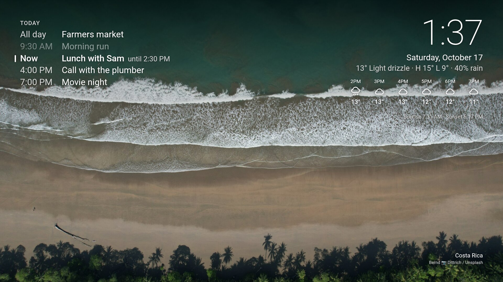

# tv-ambient

[](https://github.com/zhengnanli/tv-ambient-app/actions/workflows/build.yml)

An ambient screensaver for Android TV / Google TV: full-screen photos with the time,
today's calendar, weather, an hourly forecast and US National Weather Service alerts.
It replaces the built-in Ambient Mode.



- **Photos:** Unsplash (with an access key), themed by time of day: sunrise, landscapes,
  sunset, city lights. Without a key, Bing's photo of the day. Cached on the device.
- **Calendar:** any published ICS feed (Outlook, Google, ...), with recurring events,
  exceptions and Windows time zone names handled.
- **Weather:** [Open-Meteo](https://open-meteo.com) (no key). °C by default.
- **Alerts:** [api.weather.gov](https://www.weather.gov/documentation/services-web-api)
  active alerts for your point, polled every 2 minutes. Warnings override night mode.
- **Night mode:** 23:00 to 06:00, a dim clock on black.

The page is a single HTML file in a WebView (`assets/index.html`). A small Java bridge
does network requests and image caching, because the TV's WebView could not load
remote images reliably.

## Build and install

Every push to `main` is built by GitHub Actions; the APK is under the run's
**Artifacts**. Pushing a tag such as `v1.0` also publishes it as a release download.
To build locally instead:

Needs a JDK and the Android SDK (`platforms;android-34`, `build-tools;34.0.0`) at
`$ANDROID_HOME` or `~/Android/Sdk`. No Gradle.

```sh
adb connect <tv-ip>:5555
./install.sh                         # build, install, set as screensaver
./configure.sh 40.71 -74.01 'https://example.com/calendar.ics'
adb shell am start -n com.android.systemui/.Somnambulator   # start it now
```

### Signing

Builds install over each other only when they're signed with the same key. `build.sh`
signs with `SIGNING_KEYSTORE` / `SIGNING_PASSWORD` from the environment, or from
`~/.config/tv-ambient/signing.env` if it exists:

```sh
SIGNING_KEYSTORE=/home/you/.config/tv-ambient/release.keystore
SIGNING_PASSWORD=...
```

CI reads the same key from the repository secrets `SIGNING_KEYSTORE_BASE64` (the keystore,
base64) and `SIGNING_PASSWORD`. With neither, `build.sh` creates a throwaway
`debug.keystore`, whose builds need `adb uninstall com.ambient.ambient` before
installing one signed with another key.

## Settings

Open **Ambient Dashboard** from the Apps row and press **OK** on the remote: temperature
unit, 12/24-hour clock, photo source, photo interval and night-mode hours. **BACK** saves.
The screensaver itself takes no input (any button closes it), so the menu lives in the app.

Everything else (Unsplash themes, defaults) is in the `DEFAULTS` block at the top of
`assets/index.html`. Precedence: `DEFAULTS` < `config.json` < menu < `debug.json`.

To go back to Google's Ambient Mode:

```sh
adb shell settings put secure screensaver_components com.google.android.apps.tv.dreamx/.service.Backdrop
```

## Notes

- **TCL TVs** block screensavers from apps that are not running unless the app holds the
  `APP_AUTO_START` app-op. `install.sh` grants it.
- **Resolution** is 1080p. On most Google TV sets the graphics layer is capped at
  1920x1080 and upscaled; only video reaches the panel at 4K.
- **Testing:** push `{"demoAlerts": true}`, `{"forceNight": true}` or `{"demoEvents": true}`
  (placeholder agenda, as in the screenshot) as `debug.json` next to `config.json`. Files
  pushed there need `chmod 666` so the app can read them.

## License

MIT. See [LICENSE](LICENSE).
